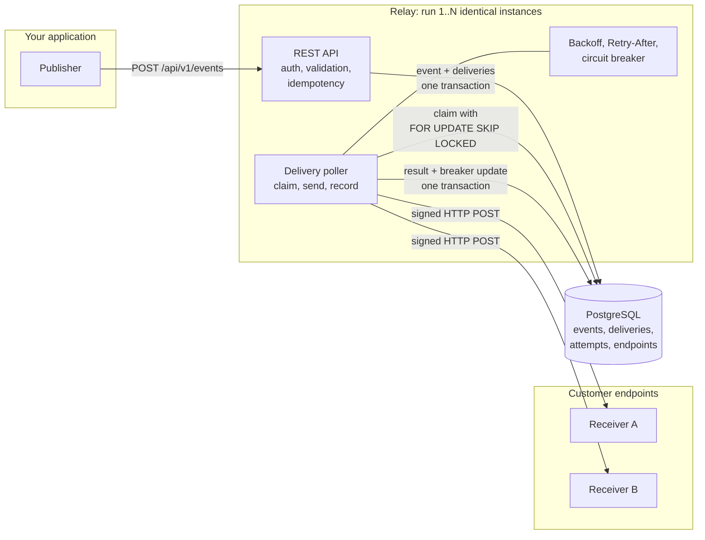
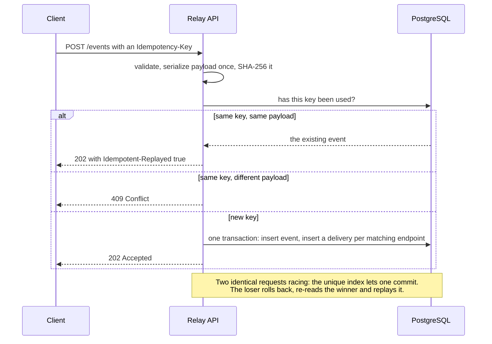
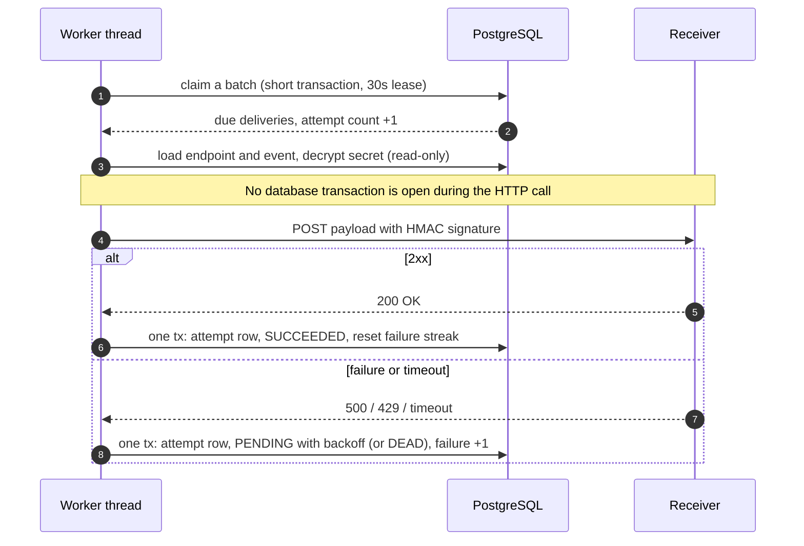
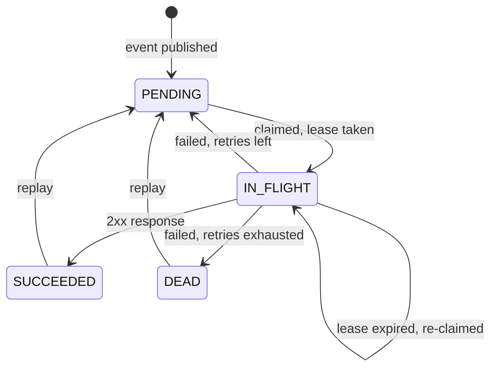
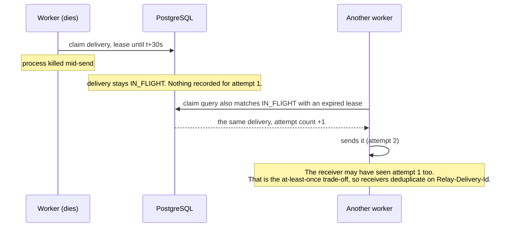
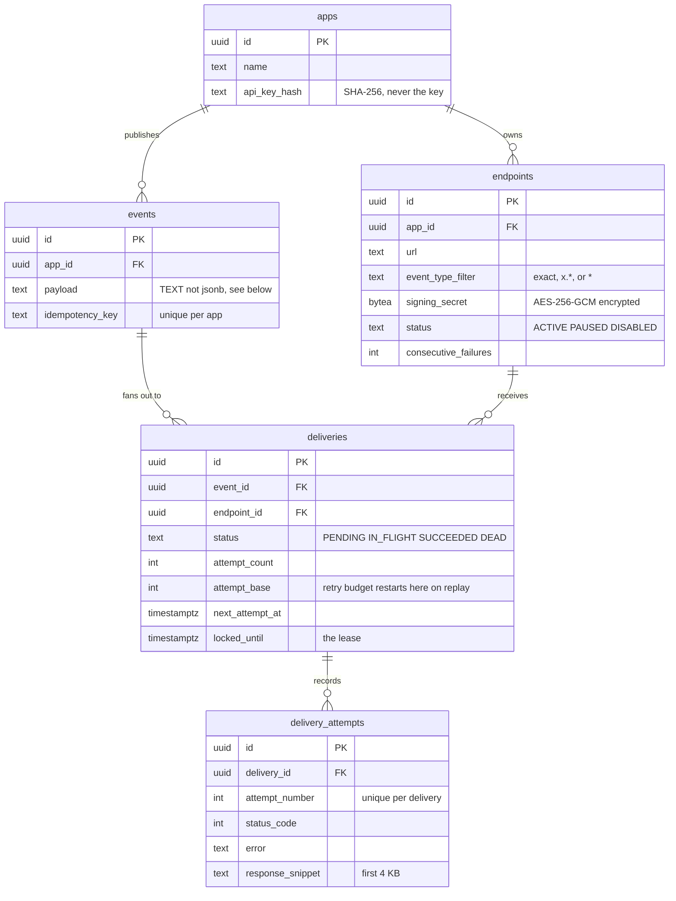

<div align="center">

# Relay

**Reliable webhook delivery as a service.**
Publish an event once. Relay delivers it to every subscribed endpoint, signed, retried, and never silently lost.

[](https://github.com/vinoth12345678910/Relay/actions/workflows/ci.yml)


</div>

---

## Why this exists

Sending a webhook is one HTTP call. Sending it **reliably** is the hard part: receivers go down, answer slowly,
return errors, get overloaded, or move. Your own servers crash mid-send. Two workers grab the same job.
A customer registers `http://169.254.169.254/` and tries to read your cloud credentials.

Relay is a small, focused service that owns all of that, backed by nothing but PostgreSQL.
No Kafka, no Redis, no message broker to operate.

> **The one-line promise:** every event published to Relay is delivered to every matching endpoint
> **at least once**, or ends up in a `DEAD` state you can see, inspect, and **replay**. It is never lost silently.

---

## Architecture



The database **is** the queue. Instances share nothing in memory, so you scale by starting another one.

### What happens when you publish an event



### What happens to a delivery



### The delivery state machine

Every status change goes through one class, `DeliveryStateMachine`. An illegal move throws.



### Surviving a crash

A worker does not hold a database lock while it sends, so a killed process cannot wedge anything.
Instead it holds a **lease**. If the lease runs out, any instance takes the delivery over.



### Data model



---

## Features

| | |
|---|---|
| **At-least-once delivery** | Nothing is lost. Failures retry with backoff; exhausted ones become `DEAD` and stay replayable. |
| **Idempotent publishing** | An `Idempotency-Key` makes retrying a publish safe, even under concurrent duplicate requests. Delivery itself is at-least-once. |
| **HMAC signatures** | Every request is signed (`HMAC-SHA256` over `timestamp.body`). [Verification guide with Python, Node and Java](docs/verifying-signatures.md). |
| **Retries with jitter** | Default schedule 10s, 30s, 2m, 10m, 30m, 2h, 6h, 12h (±20% jitter): 9 attempts over about 21 hours. |
| **`Retry-After` respected** | A `429`/`503` can lengthen the wait (bounded, never shortened below our own backoff). |
| **Circuit breaker** | After N consecutive failures an endpoint is paused. Its backlog **waits, it is not burned**. Resume drains it. |
| **`410 Gone` auto-pause** | The receiver says the address is gone, so Relay stops immediately. |
| **Crash recovery** | Lease-based. Kill a worker mid-send and another instance finishes the job. |
| **Per-endpoint concurrency cap** | One slow receiver cannot occupy every worker and starve the others. |
| **Replay** | Re-send any `DEAD` or `SUCCEEDED` delivery with a fresh retry budget. |
| **Delivery API** | Filter by status or endpoint, keyset-paginated, with every attempt's status, timing and response snippet. |
| **Multi-tenant isolation** | Apps only ever see their own data. Another app's ids return `404`. |
| **SSRF protection** | Only `http(s)`; internal, loopback and link-local (cloud metadata) addresses are refused at registration **and again at send time**. Redirects are never followed. |
| **Graceful shutdown** | Stops claiming, finishes in-flight sends (30s default), then exits. |
| **Horizontally scalable** | Run more instances against the same database. `SKIP LOCKED` keeps them from colliding. |

---

## Quick start

You need Docker and `jq`. The first build takes a few minutes while Maven downloads dependencies.

```bash
git clone https://github.com/vinoth12345678910/Relay.git && cd Relay

# Relay + PostgreSQL + a mock receiver that can misbehave on command
docker compose -f docker/docker-compose.yml up --build -d
curl -s localhost:8080/actuator/health        # {"status":"UP"}
```

### Create an app, subscribe an endpoint, publish an event

```bash
# 1. Create an app (admin token). The API key is shown ONCE.
scripts/create-app.sh my-app
export KEY=rl_live_...                        # paste the apiKey from the output

# 2. Subscribe an endpoint. The signing secret is also shown ONCE.
curl -s -X POST localhost:8080/api/v1/endpoints \
  -H "Authorization: Bearer $KEY" -H 'Content-Type: application/json' \
  -d '{"url":"http://mock-receiver:9000/hook/ok","eventTypeFilter":"order.*"}' | jq

# 3. Publish. Re-sending the same Idempotency-Key never creates a second event.
curl -s -X POST localhost:8080/api/v1/events \
  -H "Authorization: Bearer $KEY" -H 'Content-Type: application/json' \
  -H 'Idempotency-Key: order-42-paid' \
  -d '{"type":"order.paid","payload":{"orderId":42,"amount":1999}}' | jq

# 4. See what happened
curl -s "localhost:8080/api/v1/deliveries?status=SUCCEEDED" -H "Authorization: Bearer $KEY" | jq
```

### Watch it survive chaos

```bash
scripts/demo-chaos.sh        # about 90 seconds; every step asserts, and exits non-zero on failure
```

It runs six scenarios against the live stack:

| # | Scenario | What it proves |
|---|---|---|
| 1 | Receiver verifies the HMAC signature | Signing works end to end, and a bad signature would be rejected |
| 2 | Receiver fails the first 3 attempts | Retries with backoff; attempt rows show 500, 500, 500, 200 |
| 3 | **`docker kill` Relay mid-send**, then restart | Lease expiry recovers the delivery; the receiver saw it twice (at-least-once) and nothing was lost |
| 4 | **Two Relay instances**, 1000 events | 1000 distinct deliveries, **0 duplicates**: `SKIP LOCKED` works across processes |
| 5 | Dead receiver | Breaker opens, backlog stays `PENDING` (never `DEAD`), resume drains everything |
| 6 | Register `http://169.254.169.254/...` | Refused with `400` |

The mock receiver has more routes to play with: `/hook/slow/{s}`, `/hook/flaky`, `/hook/gone` (410),
`/hook/busy/{s}` (429 + `Retry-After`), `/hook/redirect` (a 302 Relay must not follow), plus `/inspect/stats`.

---

## API

All routes need `Authorization: Bearer <api key>`, except creating an app, which needs the admin token.
Errors share one shape: `{ timestamp, status, error, code, message, path, fieldErrors }`.

| Method | Path | |
|---|---|---|
| `POST` | `/api/v1/apps` | Create an app (admin token). Returns the API key once |
| `GET` | `/api/v1/apps/{id}` | Your own app only |
| `POST` | `/api/v1/endpoints` | Subscribe a URL. Returns the signing secret once |
| `GET` | `/api/v1/endpoints` · `/{id}` | List / get |
| `PATCH` | `/api/v1/endpoints/{id}` | Change url, description, or filter |
| `POST` | `/api/v1/endpoints/{id}/pause` · `/resume` | Pause with a reason; resume resets the failure streak |
| `DELETE` | `/api/v1/endpoints/{id}` | Soft delete |
| `POST` | `/api/v1/events` | Publish `{type, payload}`. Supports `Idempotency-Key`. `202` |
| `GET` | `/api/v1/events/{id}` | The event and the state of each of its deliveries |
| `GET` | `/api/v1/deliveries` | `?status=`, `?endpointId=`, `?limit=` (max 200), `?cursor=` |
| `GET` | `/api/v1/deliveries/{id}` · `/{id}/attempts` | Detail, and every attempt with status, error, timing |
| `POST` | `/api/v1/deliveries/{id}/replay` | Re-queue a `DEAD`/`SUCCEEDED` delivery. `409` otherwise |
| `GET` | `/actuator/health` | Public, no details |

**Event types** match `^[a-z0-9._-]{1,100}$`. **Filters** are exact (`order.paid`), prefix (`order.*`, which
does *not* match `orders.created`), or `*`. **Payloads** may be up to 256 KB.

### What your receiver gets

```http
POST /your/webhook HTTP/1.1
Content-Type: application/json
Relay-Event-Id: 4f1c...
Relay-Delivery-Id: 9a7e...        <- same on every retry: deduplicate on this
Relay-Attempt: 2
Relay-Timestamp: 1760000000
Relay-Signature: v1=3ba044955d5a...

{"orderId":42,"amount":1999}
```

Any `2xx` is success. Everything else, including `3xx`, is a failure and is retried.
Details and copy-paste verification code: **[docs/verifying-signatures.md](docs/verifying-signatures.md)**.

---

## Design decisions worth reading

These are the places where the obvious approach is subtly wrong.

**The claim query is the heart of it.** Workers claim work with a single `UPDATE ... WHERE id IN (SELECT ...
FOR UPDATE SKIP LOCKED)`. Locked rows are skipped rather than waited on, so any number of workers on any number of
instances can poll the same table without double-claiming or blocking. The same query reclaims `IN_FLIGHT` rows whose
lease expired, which *is* crash recovery. The attempt counter is incremented inside the claim, so a "poison" delivery
that keeps killing its worker still runs out of attempts and goes `DEAD`.

**No HTTP call ever happens inside a database transaction.** Claim, load, send and record are four separate steps.
A slow receiver can never hold a connection or a row lock.

**Partial indexes.** Over time almost every delivery is `SUCCEEDED` or `DEAD` and is never read by the claimer.
The claim indexes cover only `PENDING` and `IN_FLIGHT` rows, so they stay small however much history accumulates.
`ClaimIndexIT` asserts the planner actually uses them on a 20,000-row table.

**Idempotency is enforced by a unique index, not by checking first.** The pre-check is only a fast path. Under a race
Postgres aborts the losing transaction, so the unique violation is caught *outside* the transaction, the winner is
re-read, and the payload hash is compared again before replaying. A mutation test confirms removing either step fails the suite.

**Payloads are stored as `TEXT`, not `jsonb`.** `jsonb` reorders keys and normalizes whitespace. The HMAC is computed
over the exact bytes received, so the stored string is the thing that gets signed and sent. It is serialized once and
never again.

**Failure counting happens in one SQL statement.** `consecutive_failures = consecutive_failures + 1` with the pause
decision in a `CASE`, so twenty workers failing at once cannot lose an increment. A manual pause or a `410` reason is
never overwritten, and a soft-deleted endpoint is never resurrected by a late failure. All of that has a test.

**Keyset pagination, not offset.** `WHERE (created_at, id) < (cursor)` means new deliveries arriving mid-read can't
shift a page, and the `id` tiebreaker handles identical timestamps. Tested with inserts between page calls.

**Retry budget vs attempt number.** `attempt_count` only ever grows, which keeps attempt rows unique and the
`Relay-Attempt` header honest. Replay moves `attempt_base` forward instead, so a replayed delivery gets a full new
budget without rewriting history.

**API keys use SHA-256, not bcrypt.** Authentication looks the app up *by hash*, which needs a deterministic hash.
Salted bcrypt cannot be looked up. API keys carry 256 bits of randomness, so a slow hash adds nothing.

Longer write-up of a deliberate gap: [ADR: SSRF and DNS rebinding](docs/decisions/ADR-SSRF-dns-rebinding.md).

---

## Proof: every claim has a test

259 automated tests (131 unit, 120 integration against **real PostgreSQL via Testcontainers**, 8 for the mock receiver).
Integration tests run the real poller against a real local HTTP receiver. No mocked databases.

| Claim | Where it is checked |
|---|---|
| Two workers never claim the same delivery | `ConcurrentClaimIT`: 500 deliveries, 8 threads, 10 rounds |
| Duplicate publishes create one event, even racing | `IdempotencyIT`, `ConcurrentPublishIT`, `IdempotencyRaceIT` (forces the unique-violation path) |
| One app can never read or change another's data | `TenantIsolationIT`, `DeliveryApiIT`, `EndpointApiIT` (every verb, every route) |
| A killed worker's delivery is recovered | `DeliveryPollerIT` (expired vs live lease), `scripts/demo-chaos.sh` step 3 |
| Retries, backoff and `DEAD` after the budget | `DeliveryPollerIT`, `DeliveryPollerDeadIT`, `BackoffPolicyTest` |
| Breaker trips, holds the backlog, drains on resume | `CircuitBreakerIT`, `CircuitBreakerPollerIT` |
| `Retry-After` lengthens but never shortens the wait | `RetryAfterParserTest`, `DeliverySenderTest`, `DeliveryResultHandlerIT` |
| Replay gives a fresh budget and keeps attempt numbers unique | `DeliveryReplayPollerIT` |
| A slow endpoint can't starve a fast one | `DeliveryPollerEndpointCapIT` |
| Redirects are not followed, timeouts fail cleanly | `DeliverySenderTest` |
| SSRF ranges are blocked | `SsrfGuardTest`, `EndpointApiIT` |
| Graceful shutdown waits for in-flight sends | `DeliveryPollerIT` |
| Illegal status changes are impossible | `DeliveryStateMachineTest` (all 16 transitions) |

Several of the guarding tests were checked with **mutation testing**: deliberately breaking the code (dropping a tenant
filter, removing the `leave()` that frees a concurrency slot, flipping `>=` to `>`) and confirming the suite goes red.
Where a mutant survived, the test gap was closed.

---

## Measured

Everything below ran on a laptop in Docker (Postgres, 2 Relay instances, and the mock receiver on one 8 GB VM),
generated by `scripts/load-test.sh`, which starts one `curl` per request. That tool is the bottleneck, so treat these
as **lower bounds, not benchmarks**.

| | Result |
|---|---|
| Chaos demo, 6 scenarios | all pass, about 90 s |
| 1000 events across 2 instances | 1000 deliveries, **0 duplicates** |
| 2000 events, fast receiver | publish ≈ 190 to 310 events/s; end to end ≈ 105 deliveries/s (includes publish time) |

**What measuring caught:** the first load run delivered only 45/s to a fast receiver. The per-endpoint concurrency cap was
turning most of every claimed batch away and parking those deliveries for 5 seconds. Turned-away deliveries now retry
after 250 ms, and the same run more than doubled. The cap's effect on a single very hot endpoint is real: by default
each instance sends to one endpoint at most 4 at a time.

---

## Configuration

Spring Boot maps `RELAY_FOO_BAR` to `relay.foo-bar`. Copy [`.env.example`](.env.example) for the full list.

| Variable | Default | Meaning |
|---|---|---|
| `RELAY_ADMIN_TOKEN` | *required* | Protects `POST /api/v1/apps` |
| `RELAY_SECRET_ENCRYPTION_KEY` | *required* | base64; encrypts endpoint signing secrets (AES-256-GCM) |
| `RELAY_WORKER_POOL_SIZE` | 5 | Concurrent sends per instance |
| `RELAY_PER_ENDPOINT_MAX_CONCURRENCY` | 4 | Concurrent sends to one endpoint per instance (≤ pool size) |
| `RELAY_RETRY_SCHEDULE` | `10,30,120,600,1800,7200,21600,43200` | Seconds between attempts; attempts = steps + 1 |
| `RELAY_BREAKER_THRESHOLD` | 20 | Consecutive failures before an endpoint is paused |
| `RELAY_RETRY_AFTER_MAX_SECONDS` | 3600 | Cap on a receiver's `Retry-After` |
| `RELAY_LEASE_SECONDS` | 30 | Must exceed the HTTP timeout + 5s, or the app refuses to start |
| `RELAY_HTTP_CONNECT_TIMEOUT_MS` / `_TOTAL_TIMEOUT_MS` | 3000 / 5000 | Per-send timeouts |
| `RELAY_WORKER_ENABLED` | true | `false` = API-only node |
| `RELAY_SSRF_ALLOW_PRIVATE_NETWORKS` | false | Allow private ranges (loopback and cloud metadata stay blocked). **Local/demo only** |

Misconfiguration fails fast at startup with a clear message (for example a lease shorter than the HTTP timeout, which would
let a slow send be delivered twice).

---

## Build and test

```bash
./mvnw verify        # JDK 21. Integration tests start PostgreSQL with Testcontainers, so Docker must be running
```

Use **JDK 21**. A test class placed under `src/main` fails the build on purpose (a guard against a classpath mix-up
that bit this project once).

```
.
├── relay-server/        the service
│   └── src/main/java/com/relay/server/
│       ├── app/  endpoint/  event/     tenants, subscriptions, publishing
│       ├── delivery/                   state machine, attempts, Delivery API, replay
│       ├── worker/                     poller, claimer, sender, backoff, breaker, Retry-After
│       ├── security/                   API-key + admin filters, SSRF guard, secret encryption
│       └── common/  config/            errors, cursors, typed configuration
├── mock-receiver/       a webhook receiver that misbehaves on command
├── docker/              compose files (+ a second-instance overlay)
├── scripts/             chaos demo, load test, create-app
└── docs/                signature verification, architecture decisions
```

---

## Honest limitations

Knowing what a system does *not* do is part of trusting it.

* **At-least-once, not exactly-once.** A receiver can see a delivery twice (a worker dying mid-send is the demonstrated
  case). Receivers must deduplicate on `Relay-Delivery-Id`. Relay is built so that never losing an event costs a rare duplicate.
* **No ordering guarantee.** Events can be delivered out of order, especially across retries.
* **DNS rebinding gap.** The SSRF check resolves the host before sending; the JDK `HttpClient` resolves it again when it
  connects. [The ADR](docs/decisions/ADR-SSRF-dns-rebinding.md) explains the fix (IP pinning) and why it is deferred.
  In production, also block internal ranges at the network layer.
* **Concurrency caps are per instance.** Two instances means twice the per-endpoint cap.
* **Not built yet:** Prometheus metrics, a data-retention job (`RELAY_RETENTION_DAYS` exists but nothing reads it),
  API-key rotation, and rate limiting.
* **Security defaults.** The `dev` profile is the default and ships **well-known demo credentials**
  (`dev-admin-token`). They are for local use only. In any real deployment set `SPRING_PROFILES_ACTIVE=prod` and provide your own
  `RELAY_ADMIN_TOKEN` and `RELAY_SECRET_ENCRYPTION_KEY`. Never run the demo compose file on a public host.

---

<div align="center">
Built with Java 21, Spring Boot 4, PostgreSQL, Flyway and Testcontainers.
</div>
